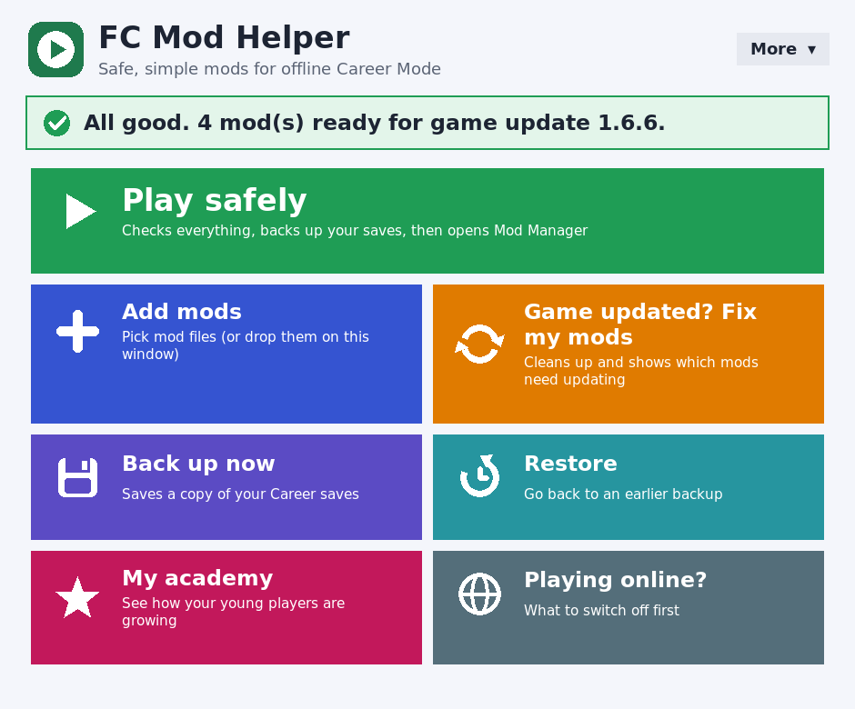
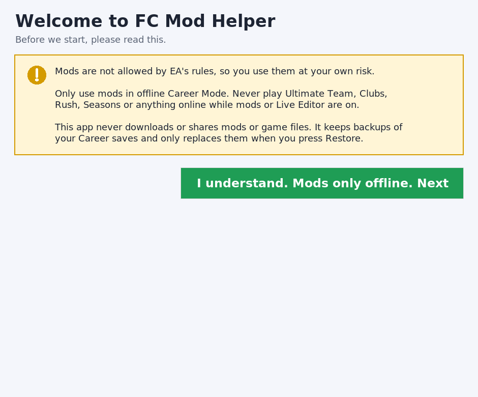
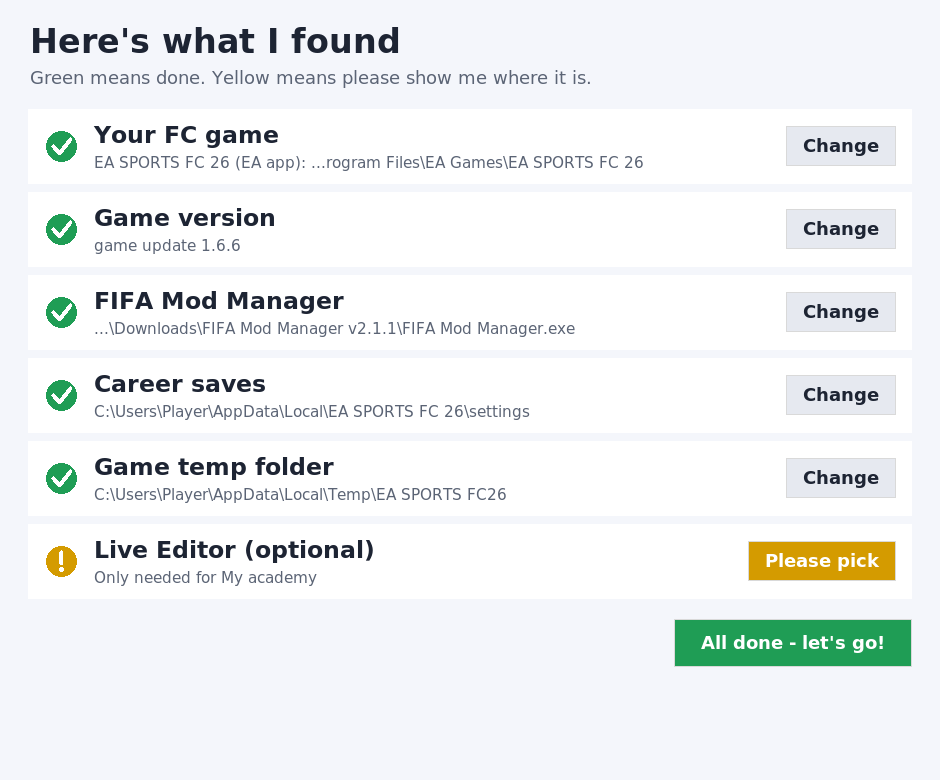
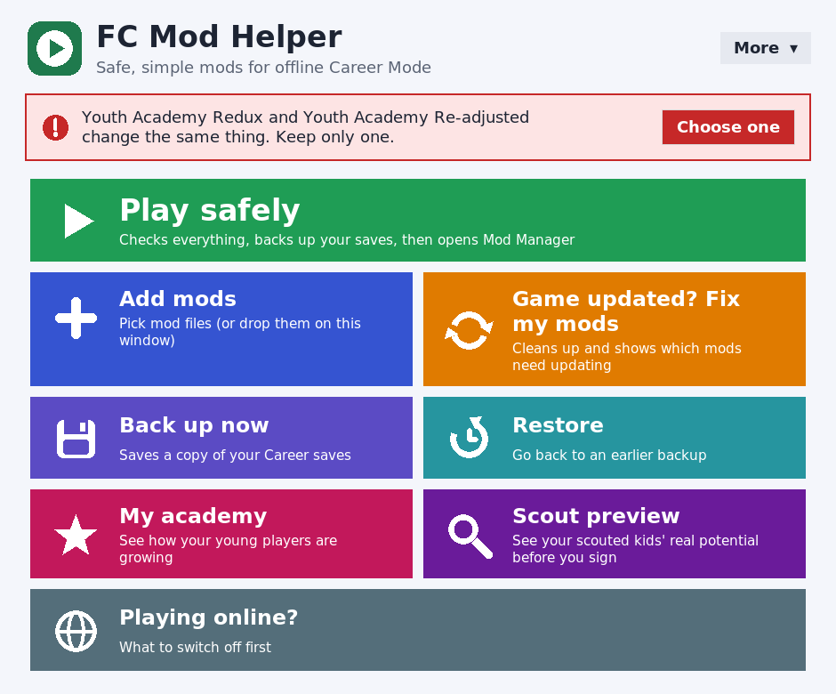
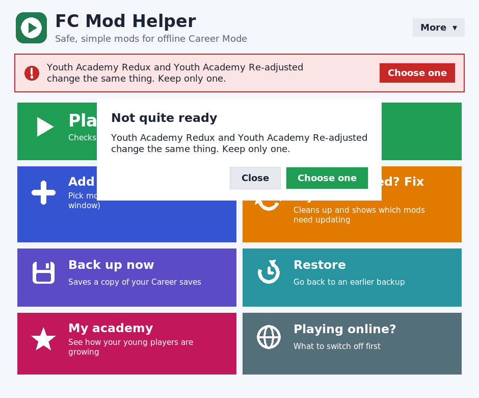
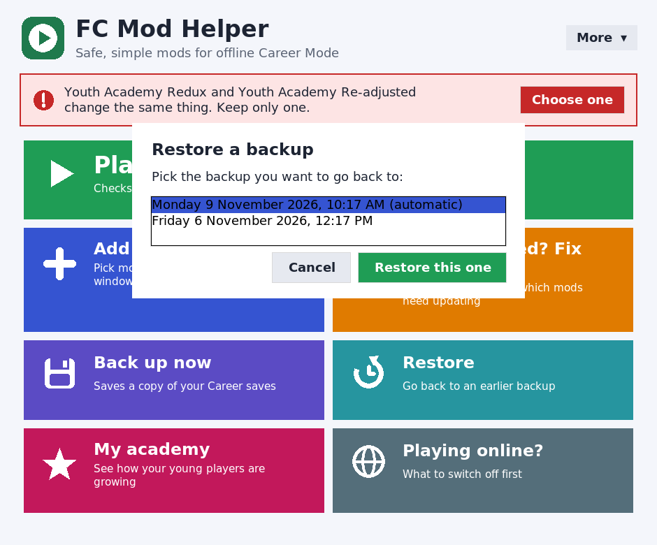
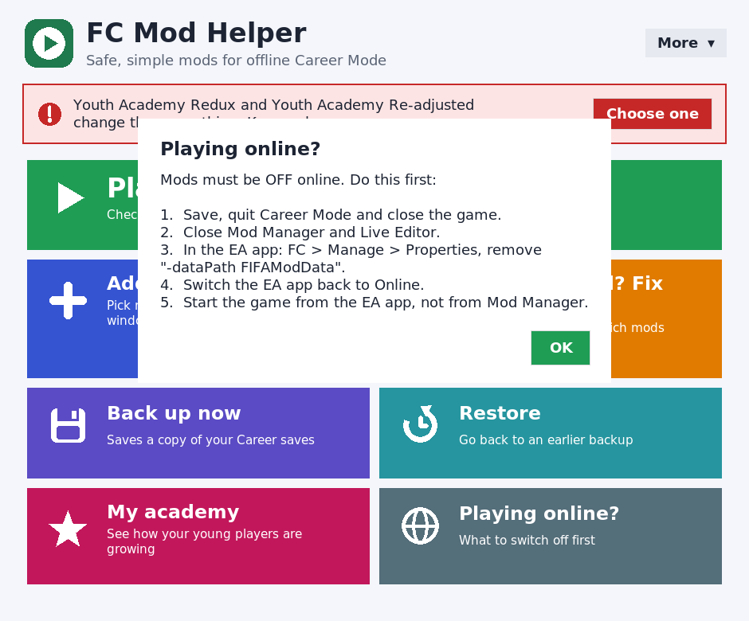
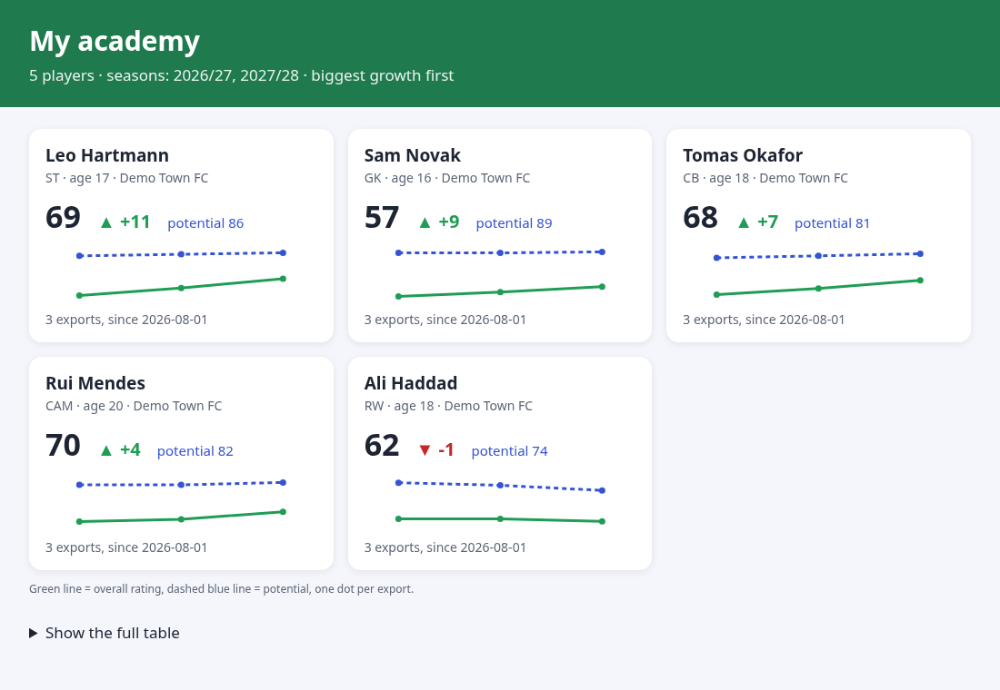

# FC Mod Helper

**Download `FC Mod Helper.exe` from [Releases](https://github.com/masterred92/fc-mod-helper/releases/latest) and double-click it.**

Direct link: [FC Mod Helper.exe (latest)](https://github.com/masterred92/fc-mod-helper/releases/latest/download/FC.Mod.Helper.exe).
GitHub saves it as `FC.Mod.Helper.exe` (it swaps spaces for dots); it's the same app.

That's it. No Python, no terminal, no typing folder paths.

> **Windows may say "Windows protected your PC".** The app isn't code-signed (signing costs money),
> so Windows doesn't recognise it yet. Click **More info**, then **Run anyway**.

FC Mod Helper is a free helper for **EA SPORTS FC 26 / FC 27 on PC** players who use mods in
**offline Career Mode**, especially for the **youth academy**.

## ⚠️ Please read: mods are at your own risk

- **EA's rules don't allow mods.** Use them at your own risk.
- Only use mods in **offline Career Mode**.
- **Never** play Ultimate Team, Clubs, Rush, Seasons or anything online while mods or Live Editor
  are on. The **Playing online?** button shows what to switch off.
- The app shows this warning the first time you open it.

## What the buttons do

| Button | What happens |
|---|---|
| **Play safely** | Checks everything. Backs up your Career saves if the last backup is more than a day old. If all is well, it opens FIFA Mod Manager. If not, it tells you the problem in one sentence with a button to fix it. |
| **Add mods** | Pick one or many mod files (or drag them onto the window). The app names them, notes which game update they're for, and warns you straight away if two mods change the same thing, so you can keep just one. |
| **Game updated? Fix my mods** | After a game update: asks before cleaning up old mod files (never your saves), and opens the pages of the mods that need a new version. When you drop updated mods into your **Mods** folder, it spots them by itself. |
| **Back up now** / **Restore** | Saves a copy of your Career saves and Mod Manager settings. Restore shows a list of backups by date, and always backs up what you have now first. |
| **My academy** | If Live Editor is installed, puts the academy script in its scripts folder for you. Then shows your young players' growth as a page with arrows and charts. |
| **Playing online?** | A short checklist of what to switch off. It doesn't change anything. |

The coloured bar at the top always tells you, in one sentence, whether you're good to go
(green), something needs a look (yellow) or something needs fixing first (red).
Less common things live under **More**.

## First run

1. Read the warning and press **I understand**.
2. The app looks for your game (EA app, Steam, Epic and the Windows registry), FIFA Mod Manager,
   your game version, your Career saves, the game's temp folder and Live Editor.
3. Green tick = found. Yellow = please pick it (a normal folder picker opens).
4. Press **All done - let's go!**

## A simple academy setup

Get the tools from their own authors:
[FIFA Mod Manager](https://fifaeditortool.com/download) (2.1.1+ for FC 26, 2.2.0+ for FC 27) and,
if you want the academy tracker, [Live Editor](https://github.com/xAranaktu/FC-26-Live-Editor)
(official Patreon only). Put the EA app in **Offline** mode.

A good starting set (pick **one** academy mod, because they clash and the app will warn you):

| What for | Mod |
|---|---|
| Academy (pick one) | [Youth Academy Redux](https://www.nexusmods.com/easportsfc26/mods/92), [Youth Academy Re-adjusted](https://www.nexusmods.com/easportsfc26/mods/1508) or [KIARIKA Career Mode Overhaul](https://www.nexusmods.com/easportsfc26/mods/77) |
| Development | [Complete Player Development](https://www.nexusmods.com/easportsfc26/mods/119) |
| Regen faces | [Better Regen Minifaces](https://www.nexusmods.com/easportsfc26/mods/49) |
| Smoother game | [KIARIKA Optimization Overhaul](https://www.nexusmods.com/easportsfc26/mods/79) |

Then press **Add mods**, pick the files, and press **Play safely** whenever you want to play.

## More screenshots

| | |
|---|---|
|  |  |
|  |  |

*(Screenshots use made-up demo data.)*

## What it never does

- It never downloads, includes or shares mods, EA game files or Live Editor. You get those from
  their authors.
- It never opens or changes mod files. It only remembers where they are, a fingerprint (checksum)
  and which game update they're for.
- It never changes the game, injects anything or gets around anything.
- It asks before deleting anything, and only ever deletes Mod Manager's rebuilt files and the game's
  temp folder. It only touches your Career saves when you press **Restore** (after backing up first).

## Where things are kept

Everything the app makes goes in `Documents\FC Mod Helper` (`Mods`, `Backups`, `Academy`).
Its settings are in `%APPDATA%\fc-mod-helper\ledger.json`. More detail: [docs/paths.md](docs/paths.md).

## Not tested on a real PC yet

This version was built and tested automatically (Windows and Linux test machines) but **not yet on a
real gaming PC with FC installed**. In particular, please check:

- that the app finds your game, Mod Manager and Live Editor (otherwise pick them; that's fine);
- the game version it shows matches your game;
- the academy script, which hasn't been run in-game yet. See [docs/academy-tracker.md](docs/academy-tracker.md).

## For power users: the command line

Everything the buttons do is also available as the `fcmh` command (Python 3.11+, no required
packages): `pip install .` then `fcmh --help`. It covers the ledger, `check`, `post-patch`
(with `--dry-run`), `rescan`, `backup create/list/verify/restore`, `academy report` and
`online-checklist`. The app itself can be run with `fcmh gui` or `python -m fcmh.app`.

Development: `pip install -e ".[dev]"` then `python -m pytest`. Screenshots:
`xvfb-run python tools/screenshots.py`. Icons are drawn by `tools/make_icons.py`.

## License

[MIT](LICENSE). Copyright (c) 2026 fc-mod-helper contributors. Not affiliated with EA, the FIFA
Editor Tool team, Live Editor's author or any mod author.
